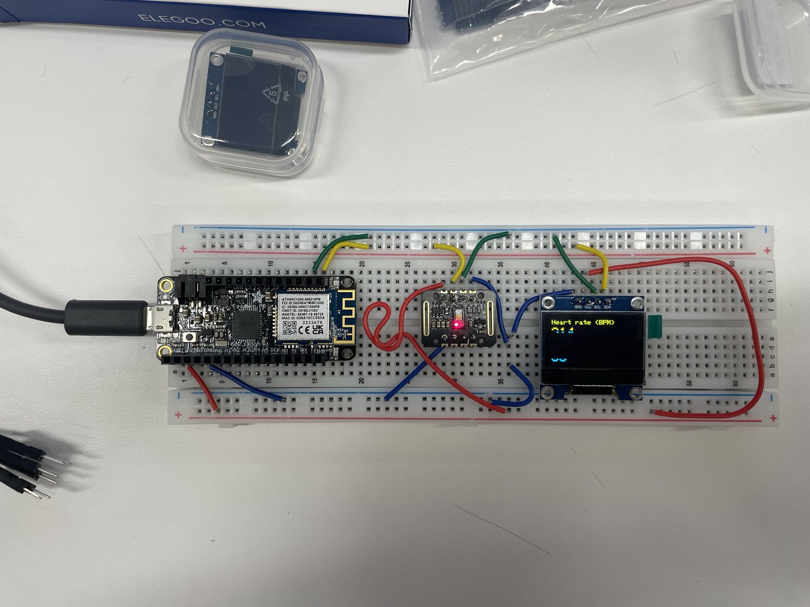
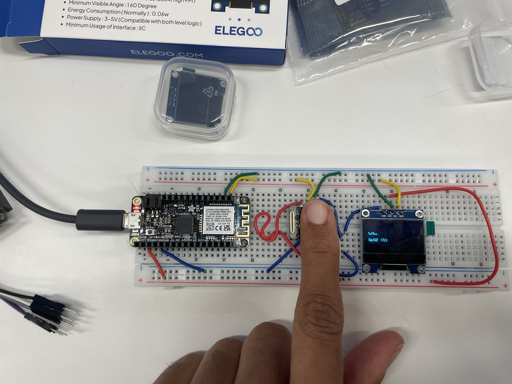
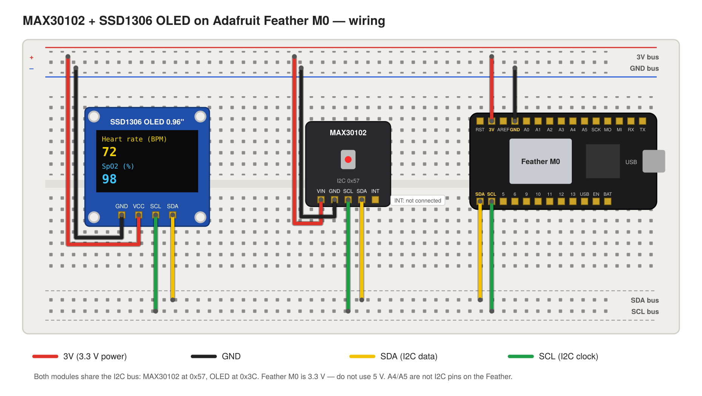

# MAX30102 Heart Rate & SpO2 with OLED Display

An Arduino sketch that reads heart rate and blood oxygen (SpO2) from a MAX30102 pulse oximetry sensor and shows the results on a 0.96" SSD1306 OLED display. It also prints the readings to the Serial Monitor / Serial Plotter.

This sketch is a modified version of SparkFun's **Example 8 – SPO2** from the [SparkFun MAX3010x library](https://github.com/sparkfun/MAX30105_Breakout). The main difference: the original prints results only to the Serial Monitor, while this version also displays them on an OLED screen.

*The assembled circuit: OLED (left), MAX30102 sensor (center), Feather M0 (right).*

*Taking a reading: hold your finger steadily on the sensor.*

## Parts list

| Part | Notes | Where to buy |
|---|---|---|
| Adafruit Feather M0 WiFi (ATWINC1500) | Used in this build. Any Feather M0 board works; the WiFi isn't used. | [Adafruit (product 3010)](https://www.adafruit.com/product/3010) |
| MAX30102 pulse oximeter / heart rate sensor module | I2C, address 0x57 | [Amazon – Diitao MAX30102](https://www.amazon.com/dp/B0BBDWLP86) |
| ELEGOO 0.96" OLED display, SSD1306, 128×64, I2C (4-pin) | Address 0x3C. Works at 3.3 V. | [Amazon – ELEGOO 0.96" OLED](https://www.amazon.com/dp/B0D2RMQQHR) |
| Breadboard (full size) and jumper wires | Any standard breadboard | — |
| Micro-USB cable | Data cable (not charge-only) for uploading the sketch | — |
| Rubber band or tape | Holds your finger on the sensor; steady pressure gives much better readings | — |

Links are for reference; equivalent parts from other sellers work the same way. Some boards come with the header pins unsoldered, so you may need to solder them before using a breadboard.

## Wiring

Both modules share the I2C bus, so they connect to the same SDA and SCL pins on the Feather.

In the photo, the outer breadboard rails are used as shared buses: one pair for 3V and GND, the other pair for SDA and SCL. Wire colors in the diagram: red = 3V, black = GND, yellow = SDA, green = SCL.

| Module pin | Feather M0 pin |
|---|---|
| MAX30102 VIN | 3V |
| MAX30102 GND | GND |
| MAX30102 SDA | SDA |
| MAX30102 SCL | SCL |
| OLED VCC | 3V |
| OLED GND | GND |
| OLED SDA | SDA |
| OLED SCL | SCL |

**Notes:**
- The Feather M0 is a 3.3 V board, and its pins aren't 5 V tolerant. Power both modules from the **3V** pin.
- On the Feather M0, A4 and A5 are **not** I2C pins (unlike the Arduino Uno). Use the pins labeled SDA and SCL.
- I2C addresses: MAX30102 = `0x57`, OLED = `0x3C` (some modules use `0x3D`; change `OLED_ADDRESS` in the sketch if needed).

## Libraries

Install these from the Arduino Library Manager:

- SparkFun MAX3010x Pulse and Proximity Sensor Library
- Adafruit SSD1306
- Adafruit GFX Library

## Usage

1. Wire the circuit as shown in the wiring diagram.
2. Install the libraries.
3. Upload `MAX30102_SpO2_OLED.ino` to the Feather M0.
4. Place your finger on the sensor and hold it steady.
5. After about 4 seconds (the first 100 samples), heart rate and SpO2 appear on the OLED and update about once per second. The display shows `--` when a reading isn't valid yet.
6. Optional: open the Serial Monitor or Serial Plotter at **115200 baud** to see the readings there too.

## Changes from the SparkFun example

**Added**
- OLED output: heart rate and SpO2 are displayed on an SSD1306 OLED using the Adafruit SSD1306/GFX libraries.
- `updateDisplay()` function: shows HR and SpO2 on the OLED, or `--` when a reading is invalid. Called after each HR/SpO2 calculation.
- `showMessage()` function: shows status messages on the OLED (e.g. "Place finger on sensor...", "Sensor not found!").

**Removed**
- The "Press any key to start conversion" prompt and the wait for a keypress, so the sketch starts on its own.
- `pulseLED` (pin 11) and `MAX_BRIGHTNESS`, which were defined in the original but never used.
- Printing of raw `red=` and `ir=` values for every sample.

**Changed**
- Serial output: instead of 25 lines per second with raw values and validity flags, the sketch prints one line per calculation (about once per second) in the format `HR:72,SpO2:98`, which the Serial Plotter can read. Invalid readings print as `0`.
- The "sensor not found" error message now names the MAX30102 (instead of MAX30105) and also appears on the OLED.

**Unchanged**
- All sensor settings (LED brightness, sample averaging, sample rate, pulse width, ADC range).
- The 100-sample buffer, the shift-25-samples loop, and Maxim's `maxim_heart_rate_and_oxygen_saturation()` algorithm.

## Troubleshooting

- **No serial output:** the Feather M0 has native USB, so text printed before the Serial Monitor connects can be lost. Check that the monitor is set to 115200 baud and the correct port is selected.
- **OLED not found:** check that the OLED's header pins are soldered and that VCC/GND aren't swapped. Run an I2C scanner sketch to see which addresses respond.
- **OLED not found only when the MAX30102 is connected:** some MAX30102 modules (often the small purple boards) pull the I2C lines up to 1.8 V, which is too low for the SSD1306. Look for a 1.8V/3.3V solder jumper on the sensor board and set it to 3.3 V.
- **Invalid or jumpy readings:** hold your finger with steady, light pressure (a rubber band helps). Pressing too hard or moving changes blood flow and throws off the readings.

## Credits

- Original example by Nathan Seidle, SparkFun Electronics (October 2016): [SparkFun MAX30105 Breakout](https://github.com/sparkfun/MAX30105_Breakout)
- Based on Maxim Integrated's MAXREFDES117 reference design and RD117_LILYPAD.ino
- SpO2 and heart rate algorithm (`spo2_algorithm`) by Maxim Integrated
- OLED display libraries by Adafruit

Please see the SparkFun library's license file for license details on the original code.

## Disclaimer

This is a hobby/educational project, not a medical device. Don't use its readings for medical decisions.
